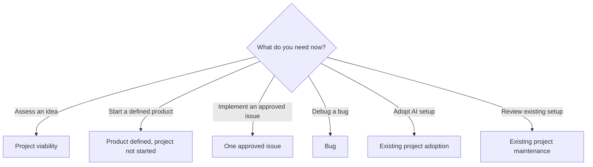

# Workflows

Scenario-based guide for using `ai-setup`.

These routes are suggestions, not a required sequence. Use only the steps that help with the task. For a single reusable workflow, load its skill; for durable multi-chat context, start from a Project Instruction preset.

A project may move from discovery to decisions, planning, GitHub Issues, implementation, verification, and pull requests as needed. `docs/` describes verified behavior; `knowledge/` preserves durable approved intent and context when useful. Retrospectives may improve later workflows. These are connected routes, not required stages for every change.

## Router

Choose the route that matches the work in front of you. These are independent entry points; the diagram does not prescribe a lifecycle or require moving through every route. The detailed guidance below remains the source of truth if Mermaid is unavailable.

Use the matching section below for the complete steps, links, and boundaries. None of the branches requires the others.

| If you're... | Go to |
| --- | --- |
| Unsure whether an idea is worth building | [Project viability](#project-viability) |
| Starting with an idea | [Only an idea](#only-an-idea) |
| Planning a product that has not started | [Product defined, project not started](#product-defined-project-not-started) |
| Setting up AI in an empty repo | [Empty repo needs minimal AI setup](#empty-repo-needs-minimal-ai-setup) |
| Adopting configuration into an existing project | [Existing project adoption](#existing-project-adoption) |
| Reviewing configuration that's already in use | [Existing project maintenance](#existing-project-maintenance) |
| Retrieving or reviewing durable project knowledge | [Project knowledge](#project-knowledge) |
| Creating, cleaning, or reviewing personal learning notes | [Personal learning notes](#personal-learning-notes) |
| Creating a multi-chat workspace | [New ChatGPT or Claude Project](#new-chatgpt-or-claude-project) |
| Researching or comparing options | [Research and comparison](#research-and-comparison) |
| Clarifying a feature | [Feature is still unclear](#feature-is-still-unclear) |
| Working from an approved spec | [Feature already has an approved spec](#feature-already-has-an-approved-spec) |
| Implementing one issue | [One approved issue](#one-approved-issue) |
| Coordinating related issues | [Several related issues](#several-related-issues) |
| Debugging a bug | [Bug](#bug) |
| Improving tests | [Testing](#testing) |
| Creating repeatable real-app verification | [Application verification](#application-verification) |
| Maintaining existing verification instructions | [Verification maintenance](#verification-maintenance) |
| Getting an independent review | [Independent review](#independent-review) |
| Preparing a commit, PR, or merge | [Git and GitHub delivery](#git-and-github-delivery) |
| Handing work to another chat or agent | [Continue work elsewhere](#continue-work-elsewhere) |
| Creating reusable AI configuration | [Need new AI configuration](#need-new-ai-configuration) |
| Improving an existing workflow | [Workflow improvement](#workflow-improvement) |

## Project viability

Use `project-viability` when the open question is whether a real problem warrants new software at all. Compare the best build case against simpler solutions, and end with BUILD, VALIDATE FIRST, or DON'T BUILD. This precedes requirement discovery only when useful; it is not a required stage or an agent orchestration workflow. Complex independent debate belongs to `adversarial-discovery`.

## Only an idea

If the value of building is still in doubt, start with [project viability](#project-viability). Otherwise go directly to discovery.

Use `product-grill` when outcomes, users, scope, or product behavior need clarification and the user should not have to make technical design choices. Use `grill-me` when the user wants to resolve product and technical decisions together and is comfortable with those decisions.

Flow:

product-grill or grill-me, as appropriate
→ optionally prototype for an unresolved concrete design question
→ to-spec
→ ai-config-builder adopt when the project is defined
→ to-issues when implementation is ready

Do not select stack-specific configuration before decisions justify it.

## Product defined, project not started

Use when the desired product is understood but implementation has not begun.

Flow:

product-grill or grill-me, as appropriate, when meaningful ambiguity remains
→ optionally prototype for an unresolved concrete design question
→ to-spec
→ spec-reviewer when useful
→ ai-config-builder adopt
→ to-issues

## Empty repo needs minimal AI setup

Use when the project or repository is new and needs only enough AI configuration to start working safely.

Flow:

ai-config-builder bootstrap

Bootstrap should recommend only the minimum useful starting configuration.

Do not use Bootstrap to discover what product should be built.

## Existing project adoption

Use when the project already has meaningful product, architecture, or code context.

Flow:

ai-config-builder adopt

Classify relevant reusable configuration as:

- ADD
- KEEP EXISTING
- REPLACE
- SKIP

Before changing the project, present the proposed files and classify each as ADD, KEEP EXISTING, REPLACE, or SKIP.

For local Codex setups, first check whether relevant skills are already installed globally (see [Codex shared configuration](README.md#codex-shared-configuration)). Reuse global skills when suitable rather than copying them to every repository. Keep project-specific instructions and stack-specific configuration local when justified.

Project-specific behavior and architecture take priority over reusable defaults.

## Project knowledge

Use `project-knowledge` when relevant durable context can inform a task, when an approved decision or verified lesson should be preserved, or when the user explicitly requests a Knowledge Review. Start with the repository's `knowledge/README.md` when it exists, then search only notes relevant to the current task. GitHub keeps issue and pull request history; knowledge notes link to that history rather than copying it. Do not create notes for routine changes.

During an approved issue, retrieve relevant knowledge and capture only durable outcomes. During PR review, check relevant notes against the diff and offer a review if material contradictions emerge. For existing-project adoption, inspect local knowledge and instructions, then recommend `ADD`, `KEEP EXISTING`, `REPLACE`, or `SKIP`; do not add knowledge files or replace instructions unconditionally. Run a full Knowledge Review only on request. See [project-knowledge](skills/project-knowledge/SKILL.md).

## Personal learning notes

Use [learning-notes](skills/learning-notes/SKILL.md) for requested work on personal study notes in an authorized local Markdown workspace, including notes opened in Obsidian. Use `project-knowledge` for durable project decisions and context. For teaching, practice, and learning progression, follow the relevant learning Project Instructions, such as [learning-coach](project-instructions/learning-coach.md).

## Existing project maintenance

Use when a project already has AI configuration and it may have drifted.

**Flow:** [project-audit](skills/project-audit/SKILL.md)

**Audit for:**

- stale configuration;
- duplication;
- conflicts;
- missing reusable configuration;
- reusable behavior that belongs in ai-setup.

For installed global Codex skills, inspect them with `npx skills ls -g` and update copies on demand with `npx skills update -g`. GitHub pushes do not synchronize them automatically. Update a local `ai-setup` checkout with Git separately; shared rule references and custom agent TOML files are not updated by the skills CLI. Remove local duplicates only after confirming they do not contain project-specific adaptations.

## New ChatGPT or Claude Project

Use a specialized Project Instruction preset when one clearly fits.

Available presets include:

- resume-reviews;
- learning-coach;
- TRACE;
- interview-prep;
- software-engineering-project;
- course-companion.

Use [TRACE](project-instructions/TRACE.md) for an adaptive five-stage cycle across subjects, with Learn, Review, and Exam modes. Use [learning-coach](project-instructions/learning-coach.md) when roadmap-driven technical progression, implementation, debugging, and multi-chat continuity are central.

If no specialized preset fits, start from:

project-base

Then:

preset or project-base
→ tune using current sources, context, and handoff when available
→ remove irrelevant generic behavior
→ produce final Project Instructions

Keep the complete paste-ready instructions within 8,000 characters, or a lower limit specified by the target platform. Use `ai-config-builder` to count the final text before delivery; the cap applies to every preset.

Do not blindly paste the reusable preset as the final instructions.

## Research and comparison

Use `research-and-compare` when a decision depends on external evidence or a structured comparison. For a continuing multi-chat research effort, start with `project-instructions/research-workspace.md` and adapt it to the project's sources and question.

For optional Google Gemini research, Gemini Notebook (formerly NotebookLM), Workspace, and creative-media routes, see [gemini/WORKFLOWS.md](gemini/WORKFLOWS.md). It points back to canonical skills and does not replace this router.

## Feature is still unclear

Use `product-grill` to discover and challenge product requirements when the user should not be asked to choose technical internals. Use `grill-me` when product and technical decisions are both in scope for a user who is comfortable resolving them. Both should produce clarified decisions for `to-spec`, not implementation.

If a concrete design uncertainty is easier to test than discuss, use `prototype` to compare isolated UI or logic alternatives. Skip it when discussion resolves the question. Prototypes are temporary and do not automatically become production code.

For a consequential **bounded decision** with meaningful competing options or uncertainty, optionally use `adversarial-discovery` to coordinate independent analysis, selective structured debate, and evidence-based synthesis. For a product or major feature that needs its **complete design phase** coordinated, optionally use `adversarial-design`; it selectively reuses `adversarial-discovery` and existing research, prototyping, specification, and review skills. For simpler discovery, use `product-grill` for product questions or `grill-me` when the user is resolving product and technical questions together. Both adversarial skills are experimental testing workflows, not mandatory steps for every project, and proposals remain subject to explicit user approval.

Flow:

product-grill or grill-me, as appropriate
→ optionally prototype for an unresolved concrete design question
→ to-spec
→ spec-reviewer when useful
→ to-issues

## Feature already has an approved spec

Flow:

spec-reviewer when useful
→ to-issues
→ implement-issue

## One approved issue

Flow:

implement-issue
→ pr-reviewer when independent review is useful

`implement-issue` already handles implementation, appropriate tests, verification, and delivery preparation.

## Several related issues

Use `issue-flow` when GitHub Issues already exist and need dependency-aware sequencing.

- `issue-flow plan` or “Arma un flow” reviews relevant open issues and proposes execution batches.
- `issue-flow orchestrate Batch 2` generates a current, copy-paste-ready prompt for a selected batch.
- Use `to-issues` first when an approved spec still needs to be split into issues.
- Give the generated prompt to a coding agent, or use `batch-orchestrator` when coordinated execution is useful and supported.

Planning and prompt generation do not change issue state or start implementation. This workflow is optional; skip steps that do not add value.

## Bug

Flow:

debug-with-evidence
→ pr-reviewer when independent review is useful

`debug-with-evidence` owns reproduction, diagnosis, root-cause fixing, regression protection, and verification.

## Testing

Use when test quality or missing protection is the problem.

Flow:

test-engineer
→ verify-change

Prioritize meaningful fault detection over test count or arbitrary coverage targets.

Use property-based or mutation testing only when they provide useful signal.

## Application verification

Use `create-verification-skill` when a repository needs repeatable, project-local instructions for exercising its real web, desktop, CLI, or API behavior. It creates a local `verify-<app>` skill and feature map, proves at least one journey when possible, and preserves supporting evidence.

During normal implementation or PR review, `verify-change` uses the project's existing harness or verification skill for affected journeys only. Do not generate a new verification skill for every issue, require full-map coverage on every small PR, or test against production state by default.

## Verification maintenance

Use `maintain-verification-skill` when the project's verification instructions or feature map may have drifted. Source inspection and live exercise cover every mapped feature; fix only verification instructions and report product defects separately. Do not confuse a successful maintenance run with authorization to merge.

## Independent review

Use when separating implementation and review context improves confidence.

Flow:

pr-reviewer

The PR reviewer uses `review-pr` to evaluate both:

- requirements;
- engineering quality.

## Git and GitHub delivery

Use when the main task is branch, commit, PR, or merge workflow.

Flow:

github-flow

Project-specific Git rules override reusable defaults.

## Continue work elsewhere

Use when transferring unfinished work to another chat, session, or agent.

Flow:

handoff

Prefer pointers to canonical artifacts instead of duplicating their full contents.

## Need new AI configuration

Use:

ai-config-builder build

Flow:

inspect existing configuration
→ CREATE / EXTEND EXISTING / DON'T CREATE
→ create compact configuration
→ treat as experimental
→ test on a real task

Possible artifact types:

- skill;
- agent;
- rule;
- template;
- Project Instruction.

## Workflow improvement

After meaningful real-world usage:

retro

Use evidence from actual work to decide whether something should:

- stay project-specific;
- change in ai-setup;
- become automated;
- remain unchanged.

Testing a workflow does not make it accepted or default.

## Durable decision

When a technical or product decision should remain understandable later, use:

templates/DECISION.md

Do not create decision records for trivial choices.

## Core principle

`ai-setup` preserves canonical rules, templates, project instructions, agents, and skills. Prefer shipping relevant operational guidance through self-contained installable skills, without copying entire artifacts or changing their boundaries. `npx skills` does not install Codex agent TOML files, general rules, or Project Instructions.

WORKFLOWS chooses the right tool.

Skills define procedures.

Agents isolate responsibilities.

Rules define stable constraints.

Project Instructions define long-running workspace behavior.

Templates define reusable artifact shapes.

Do not repeat a skill's internal procedure here.

Use the minimum reusable configuration that materially improves the work.
